# QuantWeave

**Connect the data. Understand the risk. Make informed decisions.**

[](https://www.python.org/)
[](https://fastapi.tiangolo.com/)
[](https://nextjs.org/)
[](https://www.typescriptlang.org/)
[](https://tailwindcss.com/)
[](#testing-suite)
[](https://playwright.dev/)

---

## 1. Professional Project Introduction

**QuantWeave** is an institutional-grade educational financial intelligence, portfolio analytics, and quantitative research platform. Engineered with a strict separation between mathematical calculation and narrative presentation, QuantWeave brings institutional investment methodologies—such as append-only double-entry transaction ledgers, Newton-Raphson XIRR solvers, lookahead-free next-bar backtesting, and tool-augmented AI agents—into an accessible, modern full-stack web environment.

Designed for quantitative analysts, financial engineers, and software engineering portfolios, the platform demonstrates rigorous data modeling, resilient UI systems, and enterprise-grade security.

---

## 2. Problem Statement

Retail investment interfaces and modern fintech prototypes suffer from three pervasive structural flaws:
1. **Mutable State & Audit Failures**: Storing user balances as mutable numbers (`UPDATE balances SET cash = cash - X`) creates race conditions and fails regulatory auditability.
2. **Backtesting Look-Ahead Bias**: Commercial simulators frequently fill orders at the same bar's Close where signals were generated, producing misleadingly high paper returns that collapse in live execution.
3. **AI Hallucinations in Finance**: Unconstrained Large Language Models fabricate financial statistics, miscalculate compounding returns, and leak private portfolio records across user sessions.

QuantWeave directly resolves these challenges with mathematically sound, reproducible software engineering.

---

## 3. Product Overview

QuantWeave provides an end-to-end quantitative workspace combining:
- **Append-Only Relational Ledgers**: Valuations and cost-basis metrics derived dynamically on-the-fly.
- **Institutional Mathematical Models**: Wilder's smoothing for RSI, Newton-Raphson solvers with bisection fallbacks for XIRR, and annualization guards.
- **Lookahead-Free Algorithmic Lab**: Strategy execution filled at next-bar Open with modeled slippage and exchange fees.
- **Deterministic AI Copilot**: Read-only tool orchestration ensuring the LLM cannot hallucinate calculations.
- **Four-Theme Dynamic Design Token System**: High-contrast, institutional visual aesthetics with zero-clipping responsive layouts.

---

## 4. Six Completed Financial Modules

| Module | Core Functionality | Algorithmic / Mathematical Features |
| :--- | :--- | :--- |
| **1. Equity Intelligence** | Historical daily OHLCV prices, multi-stock screener, comparative analytics. | Simple & Exponential Moving Averages, Wilder's smoothed RSI, MACD (12, 26, 9), Bollinger Bands, fundamental balance sheet ratios. |
| **2. Portfolio Intelligence** | Multi-portfolio tracking, deposit/withdrawal ledgers, cash management. | Append-only transaction logging with idempotency keys, Weighted-Average Cost Basis (WACB), realized/unrealized P&L, Time-Weighted Return (TWR), Newton-Raphson XIRR solver. |
| **3. FundScope** | Mutual fund discovery, NAV history, fund comparisons, expense ratios. | Lump-sum CAGR calculation, Systematic Investment Plan (SIP) future value projection, risk-adjusted performance scoring. |
| **4. MarketPulse** | Curated financial headlines, sector heatmaps, macroeconomic indicators. | Financial sentiment scoring, RBI/macroeconomic data integration, personalized user watchlists with price alerts. |
| **5. QuantLab** | Algorithmic trading strategy builder, backtesting, parameter optimization. | Lookahead-free next-bar Open execution, 5 bps slippage, 10 bps commissions, in-sample/out-of-sample grid search optimization, Sharpe & Sortino ratios, Max Drawdown. |
| **6. QuantWeave Copilot** | Conversational research assistant with verified citations. | Read-only Python tool calling, server-authenticated user context injection, prompt-injection defenses, vectorless semantic RAG retrieval. |

---

## 5. Profile Customization & Four-Theme Design System

QuantWeave incorporates a dynamic CSS custom-property design system with dual persistence (`localStorage` + PostgreSQL):
- **Signal Loom**: High-contrast, dark quantitative terminal (emerald green & dark charcoal).
- **Daybreak**: Executive daylight research interface (light pearl & deep royal blue).
- **Nebula**: Deep space quantitative aesthetic (midnight violet & celestial indigo).
- **Oceanic**: Marine research terminal (deep sea blue & teal accents).

### Six Avatar Presets & Viewport Containment
Users can customize researcher profiles with 6 preset avatars. The profile navigation dropdown calculates viewport boundaries dynamically, ensuring **zero clipping** on mobile screens (390px) and lower-resolution laptops, with full `Escape` key dismissal.

---

## 6. Application Showcase & Screenshots

### Signal Loom Quantitative Dashboard (Default Theme)
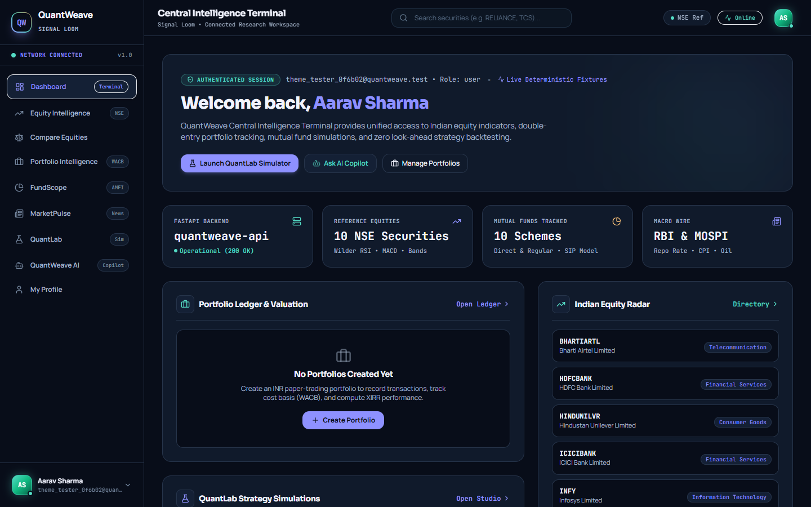

### Alternative Themes (Daybreak, Nebula, Oceanic)
| Daybreak (Light) | Nebula (Violet) | Oceanic (Teal) |
| :---: | :---: | :---: |
| 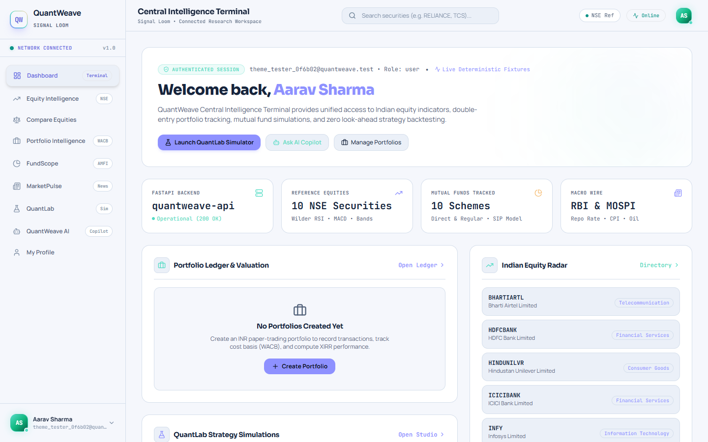 | 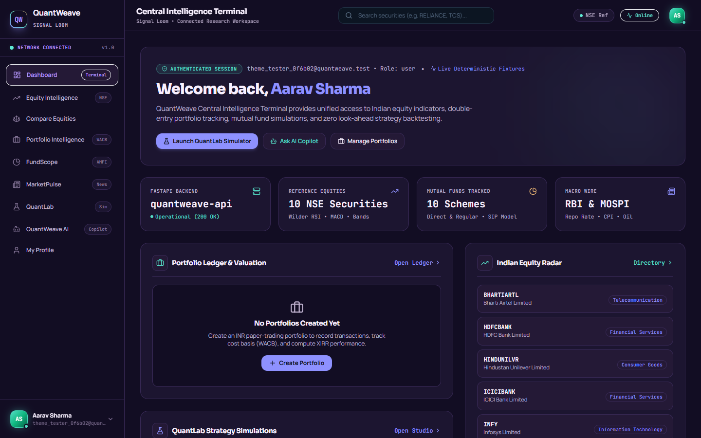 | 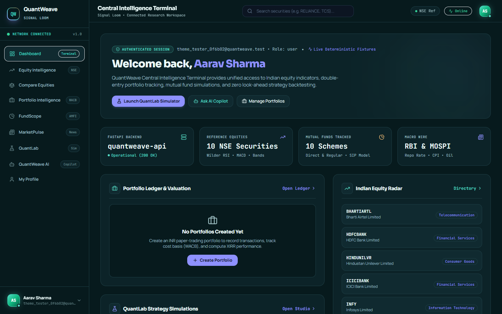 |

### Core Financial Modules
| Equity Intelligence | Portfolio Intelligence & Ledgers |
| :---: | :---: |
| 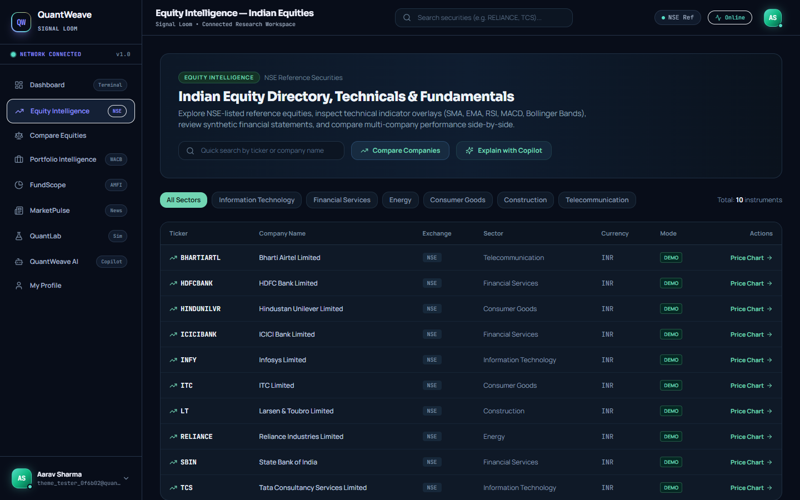 | 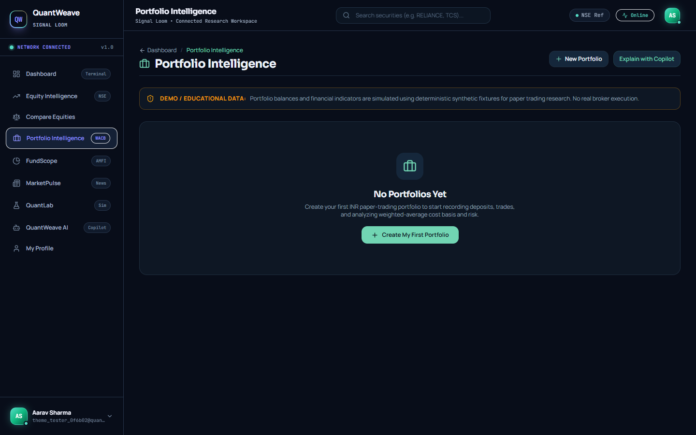 |

| FundScope Mutual Funds | MarketPulse Intelligence |
| :---: | :---: |
| 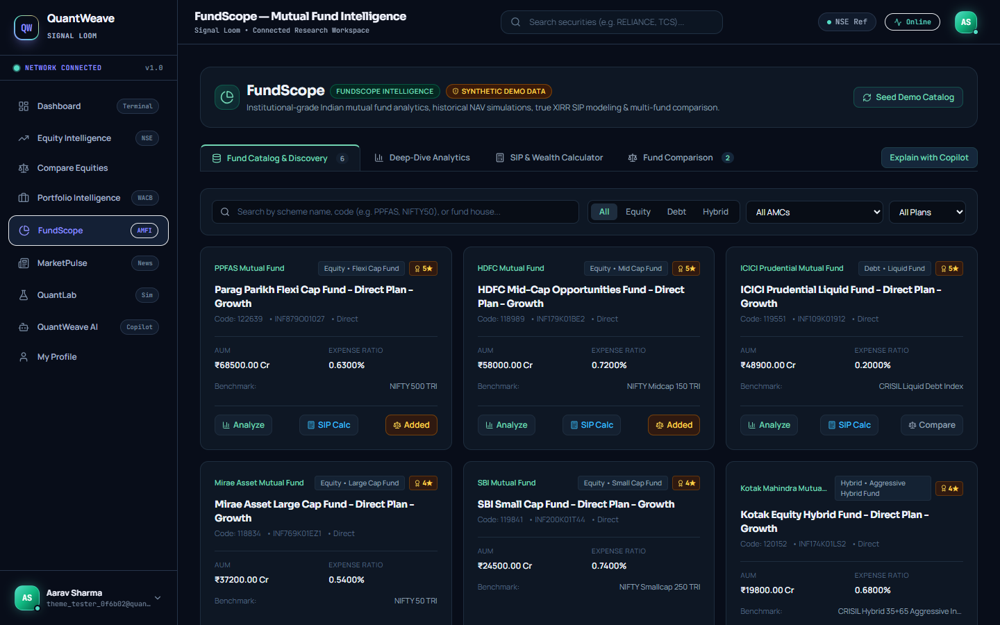 | 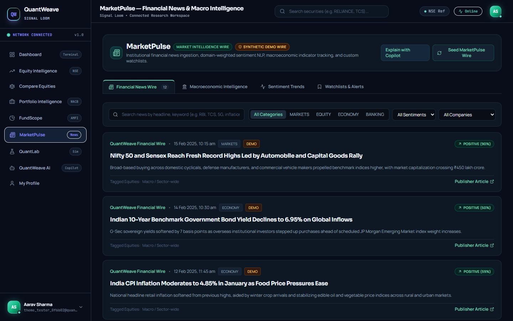 |

| QuantLab Algorithmic Backtesting | AI Copilot with Verified Citations |
| :---: | :---: |
| 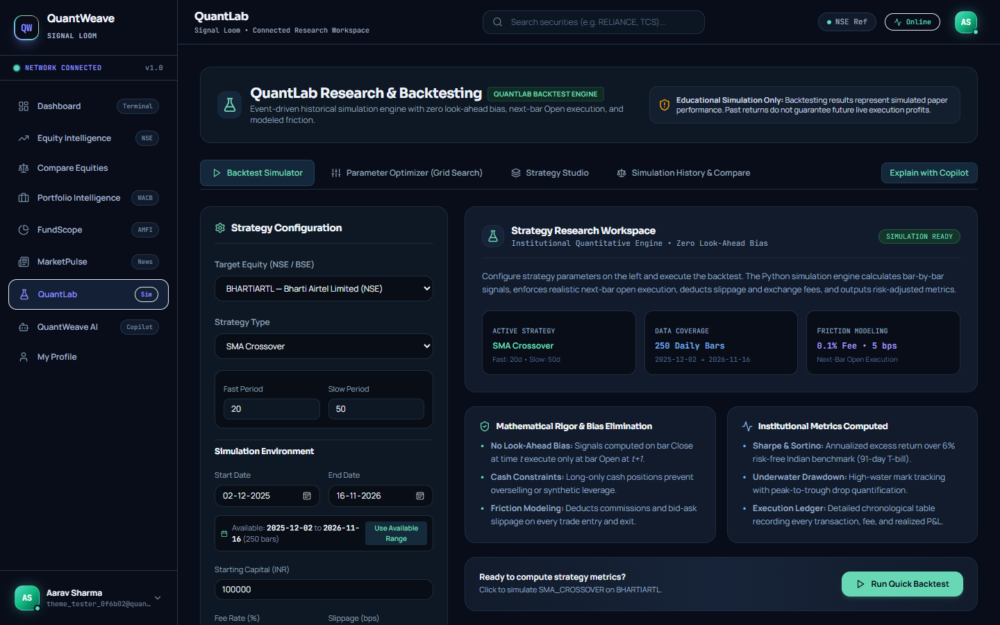 | 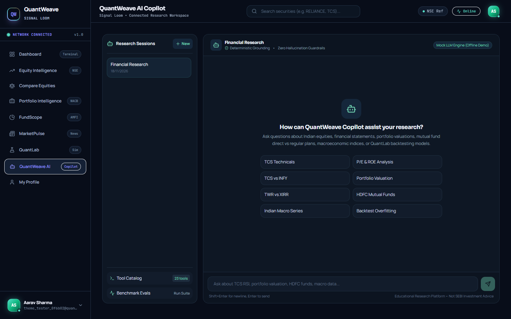 |

| Viewport-Contained Profile Menu | Profile Customization & Avatars |
| :---: | :---: |
| 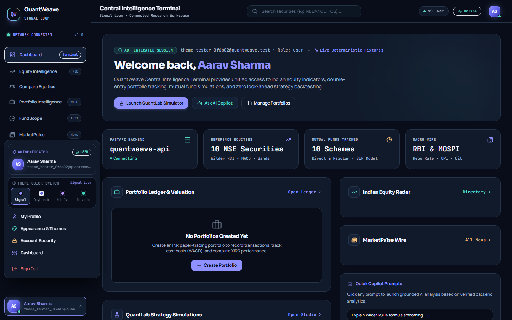 | 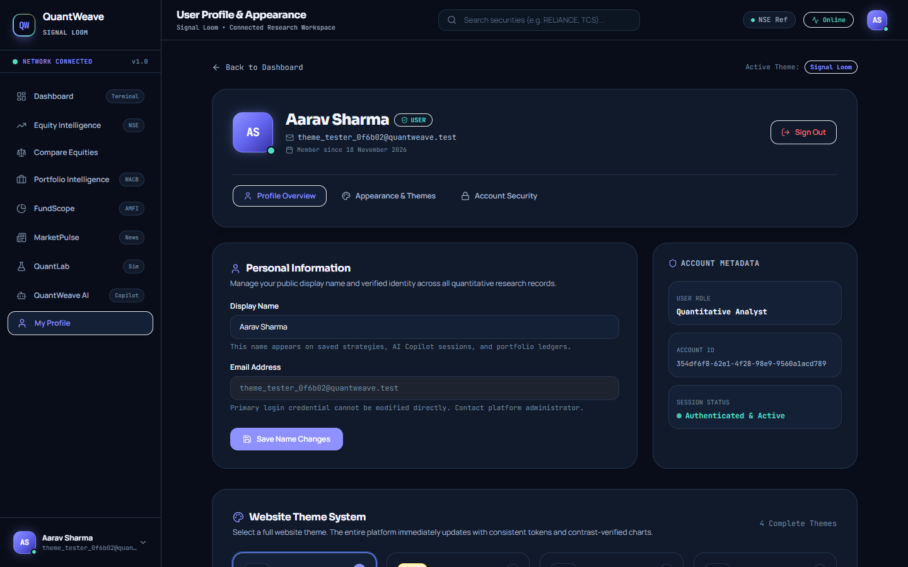 |

---

## 7. Actual Technology Stack

- **Backend Runtime**: Python 3.13
- **API Framework**: FastAPI 0.115 (Asynchronous request handling, Pydantic v2 schemas)
- **Database ORM**: SQLAlchemy 2.0 (Declarative models, generic typing, connection pooling)
- **Database Driver**: Psycopg 3.2 (PostgreSQL) / Native SQLite (Development/CI)
- **Database Migrations**: Alembic 1.13 (Linear migration revisions)
- **Frontend Framework**: Next.js 15.5 App Router & React 19
- **Type System**: TypeScript 5.7 (Strict compiler checks)
- **Styling & Tokens**: Tailwind CSS 3.4 & CSS Custom Properties
- **Testing & QA**: Pytest 8.4, AnyIO, Playwright 1.65 (Real browser automation)
- **Containerization**: Docker & Docker Compose

---

## 8. System Architecture Diagram

```
┌────────────────────────────────────────────────────────────────────────┐
│                        Next.js 15 App Router                           │
│  (React 19 Server/Client Components, Tailwind Tokens, ThemeContext)    │
└───────────────────────────────────┬────────────────────────────────────┘
                                    │ HttpOnly JWT Cookies (SameSite=Lax)
                                    │ Custom Headers (CSRF Protection)
┌───────────────────────────────────▼────────────────────────────────────┐
│                         FastAPI API Gateway                            │
│  (Lifespan Events, Sliding-Window Rate Limiter, Pydantic v2 Validation)│
└─────────┬─────────────────────────┬──────────────────────────┬─────────┘
          │                         │                          │
┌─────────▼──────────────┐ ┌────────▼──────────────┐ ┌─────────▼─────────┐
│ Financial Math Engine  │ │  QuantLab Simulator   │ │   AI Orchestrator │
│ • Wilder's RSI         │ │ • Next-Bar Execution  │ │ • Read-Only Tools │
│ • Newton-Raphson XIRR  │ │ • Slippage & Fees     │ │ • Semantic RAG    │
│ • Weighted-Avg Cost    │ │ • Train/Test Splits   │ │ • User Isolation  │
└─────────┬──────────────┘ └────────┬──────────────┘ └─────────┬─────────┘
          │                         │                          │
┌─────────▼─────────────────────────▼──────────────────────────▼─────────┐
│                     SQLAlchemy 2.0 Persistence Layer                   │
│  • Append-Only Ledgers        • User & Profile Preferences             │
│  • Daily OHLCV Price Series   • Idempotency Deduplication              │
└───────────────────────────────────┬────────────────────────────────────┘
                                    │
               ┌────────────────────┴────────────────────┐
               │                                         │
┌──────────────▼─────────────┐             ┌─────────────▼─────────────┐
│    SQLite (Local Dev/CI)   │             │   PostgreSQL 16 (Cloud)   │
│  sqlite:///quantweave.db   │             │   postgresql+psycopg://   │
└────────────────────────────┘             └───────────────────────────┘
```

---

## 9. Backend & Frontend Design

### Backend Design
- **Dependency Injection**: Database sessions (`get_db`) and authenticated user models (`get_current_user`) are injected per-request, ensuring automatic session cleanup and connection pool safety.
- **Domain Service Isolation**: Route handlers contain zero business logic. Mathematical calculations and ledger mutations reside in dedicated services (`PortfolioService`, `AnalyticsService`, `QuantLabEngine`).

### Frontend Design
- **Next.js 15 App Router**: Routes are organized under `(dashboard)/`, sharing persistent navigation layouts without client-side re-renders or layout shifts.
- **Design Token System**: Dynamic theme switches mutate `data-theme` on `<html>`, updating all CSS variables instantaneously without full-page reloads.

---

## 10. Database Architecture & Double-Entry Ledgers

QuantWeave enforces an append-only double-entry ledger in `portfolio_transactions`:
```sql
CREATE TABLE portfolio_transactions (
    id UUID PRIMARY KEY,
    portfolio_id UUID NOT NULL REFERENCES portfolios(id) ON DELETE CASCADE,
    instrument_id UUID REFERENCES instruments(id) ON DELETE RESTRICT,
    transaction_type VARCHAR(20) NOT NULL, -- 'DEPOSIT', 'WITHDRAWAL', 'BUY', 'SELL'
    shares FLOAT DEFAULT 0.0,
    price FLOAT DEFAULT 0.0,
    amount FLOAT NOT NULL,
    timestamp TIMESTAMP WITHOUT TIME ZONE DEFAULT (NOW() AT TIME ZONE 'utc'),
    idempotency_key VARCHAR(64) UNIQUE
);
CREATE INDEX idx_tx_portfolio_time ON portfolio_transactions (portfolio_id, timestamp);
```

User cash, holdings, and cost-basis are never mutated directly; they are evaluated on-the-fly via mathematical reduction over the transaction history.

---

## 11. Financial Analytics & Mathematical Methodology

- **Weighted-Average Cost Basis (WACB)**: Evaluated dynamically on sequential purchases to calculate exact realized gains on sales and unrealized paper gains on holdings.
- **Extended Internal Rate of Return (XIRR)**: Implemented using the **Newton-Raphson method** to solve the Net Present Value polynomial:
  $$\text{NPV}(r) = \sum_{i=1}^n \frac{C_i}{(1 + r)^{\frac{t_i - t_0}{365}}} = 0$$
  If Newton-Raphson fails to converge within 50 iterations, QuantWeave automatically falls back to **Bisection Search** over bracket $[-0.99, 10.0]$ to guarantee root convergence.
- **Wilder's Smoothing**: Relative Strength Index uses $\alpha = 1/14$ smoothing rather than simple moving averages, with zero-division guards for flat trading ranges.
- **Annualization Guards**: CAGR calculations are suppressed for holding periods under 365 days to eliminate distorted short-term returns.

---

## 12. QuantLab Backtesting Engine

QuantLab enforces strict institutional simulation causality:
- **Next-Bar Execution**: Signals evaluated at Bar $t$'s Close are filled strictly at Bar $t+1$'s Open.
- **Execution Friction**: Modeled with 5 basis points (0.05%) execution slippage and 10 basis points (0.10%) transaction fees.
- **Overfitting Defenses**: Supports 70/30 In-Sample and Out-of-Sample dataset splits and clamps grid search parameter combinations to 100 to prevent denial-of-service.

---

## 13. Financial AI Copilot, Tool Calling & RAG

QuantWeave Copilot enforces mathematical accuracy through structural constraints:
- **Separation of Concerns**: The LLM never computes numbers in prose. All figures are queried from verified Python tools (`get_equity_technicals`, `get_portfolio_summary`).
- **Authorization Injection**: The server overrides any client-supplied `user_id` with the authenticated session `user_id`, guaranteeing cross-tenant privacy.
- **Vectorless Semantic RAG**: Retrieves curated financial methodology chunks with explicit source citations.
- **Deterministic Mock Provider**: Configured by default (`AI_PROVIDER=mock`) for 100% offline reproducibility without cloud API keys.

---

## 14. Authentication & Security Architecture

- **HttpOnly Cookies**: JWT tokens are transmitted via `HttpOnly`, `SameSite=Lax` cookies, neutralizing client-side JavaScript token theft (XSS).
- **CSRF Defense**: Origin verification paired with mandatory custom request headers (`Content-Type: application/json` and `X-Requested-With`) on state-mutating requests.
- **Sliding-Window Rate Limiter**: In-memory rate limiting with automated stale bucket garbage collection.
- **Password Security**: Salted hashes generated using **bcrypt** (cost factor 12).
- **Upload Sanitization**: CSV uploads are validated against null-byte injections, 5MB size limits, and strict schema parsers.

---

## 15. Project Directory Structure

```
QuantWeave/
├── apps/
│   ├── api/                           # FastAPI Python Backend
│   │   ├── app/
│   │   │   ├── api/routes/            # Modular Endpoint Controllers
│   │   │   ├── core/                  # Database, Config, Security, Rate Limiter
│   │   │   ├── models/                # Declarative SQLAlchemy 2.0 Models
│   │   │   ├── schemas/               # Pydantic v2 Input/Output Schemas
│   │   │   └── services/              # Domain Services (Ledgers, Analytics, AI)
│   │   ├── alembic/                   # Linear Database Migrations
│   │   ├── tests/                     # 144 Pytest Regression Tests
│   │   ├── requirements.txt           # Production Dependencies
│   │   └── requirements-dev.txt       # Development & Playwright Dependencies
│   └── web/                           # Next.js 15 Frontend Application
│       ├── app/                       # App Router Pages & (dashboard) Layouts
│       ├── components/                # Modular UI Components (Profile, Theming)
│       ├── lib/                       # API Client & ThemeContext Provider
│       ├── middleware.ts              # Route Guards
│       ├── package.json               # Frontend Dependencies
│       └── tailwind.config.ts         # Theme Tokens & Configuration
├── contracts/                         # OpenAPI 3.0 API Specifications
├── database/                          # Reference PostgreSQL Schema (schema.sql)
├── docs/                              # Technical Documentation
│   ├── screenshots/                   # Genuine Application Screenshots
│   ├── study-guide/                   # Comprehensive 10-Part Study Curriculum
│   ├── ARCHITECTURE_OVERVIEW.md       # Detailed Architecture & Scale
│   ├── DATABASE_DESIGN.md             # ER Diagrams & Ledger Schema
│   ├── FINANCIAL_CALCULATIONS.md      # Mathematical Formulations
│   ├── QUANTLAB_METHODOLOGY.md        # Backtesting Specifications
│   ├── SECURITY_ARCHITECTURE.md       # Security Hardening Model
│   ├── POSTGRESQL_PRODUCTION_RUNBOOK.md # Production Deployment Guide
│   └── FINAL_RELEASE_VERIFICATION.md  # Comprehensive Quality Matrix
├── scratch/                           # Testing & Browser Automation Scripts
├── docker-compose.yml                 # Multi-Container Orchestration
├── pyrefly.toml                       # Python Language Server Configuration
├── pyrightconfig.json                 # Pyright Virtual Environment Config
└── README.md                          # Repository Documentation
```

---

## 16. Local Installation Guide

### Prerequisites
- Python 3.11+ (Python 3.13 recommended)
- Node.js 20+ & npm 10+
- Git

### 1. Clone the Repository
```bash
git clone https://github.com/your-username/QuantWeave.git
cd QuantWeave
```

### 2. Configure Environment Variables
Copy `.env.example` to `.env`:
```bash
cp .env.example .env
```

### 3. Setup Python Backend Environment
```bash
cd apps/api
python -m venv .venv

# Windows PowerShell:
.\.venv\Scripts\Activate.ps1
# macOS/Linux:
source .venv/bin/activate

pip install -r requirements-dev.txt
```

### 4. Setup Next.js Frontend Environment
```bash
cd ../web
npm install
```

---

## 17. Environment Variables Reference

| Variable | Default Value | Description |
| :--- | :--- | :--- |
| `ENVIRONMENT` | `development` | Runtime environment (`development`, `testing`, `production`). |
| `DEMO_MODE` | `true` | Automatically seeds demo Indian equities, funds, and statements. |
| `DATABASE_URL` | `sqlite:///./quantweave_dev.db` | SQLAlchemy database URL (SQLite for local dev, PostgreSQL for cloud). |
| `CORS_ORIGINS` | `["http://localhost:3000"]` | Whitelisted frontend origins. |
| `SECRET_KEY` | *(min 32 characters)* | Cryptographic HMAC key for JWT tokens. |
| `NEXT_PUBLIC_API_BASE_URL` | `http://localhost:8000` | Backend API URL for client-side fetches. |
| `AI_PROVIDER` | `mock` | Copilot provider (`mock`, `gemini`, `openai`). |

---

## 18. Development Startup Commands

### Start FastAPI Backend
```bash
cd apps/api
.\.venv\Scripts\python.exe -m uvicorn app.main:app --reload --port 8000
```
- API Docs: `http://localhost:8000/docs`
- Health Endpoint: `http://localhost:8000/health`

### Start Next.js Frontend
```bash
cd apps/web
npm run dev
```
- Web Application: `http://localhost:3000`

---

## 19. Testing & Verification Commands

### 1. Run Backend Pytest Suite
```bash
cd apps/api
.\.venv\Scripts\python.exe -m pytest tests/ -v
```
*Expected: 144 passed in ~115s.*

### 2. Run Frontend Production Build & Typecheck
```bash
cd apps/web
npm run build
```
*Expected: 15 / 15 static and dynamic pages compiled successfully.*

### 3. Run Playwright E2E Browser Automation
With both servers running:
```bash
.\apps\api\.venv\Scripts\python.exe scratch\run_playwright_e2e.py
```
*Expected: 10 / 10 browser scenarios passed across mobile, tablet, and desktop viewports.*

---

## 20. Technical Study Guide

Located in `docs/study-guide/`, this curriculum prepares engineers for technical interviews and quantitative software roles:
1. [`README.md`](docs/study-guide/README.md): Study guide orientation and recommended progression.
2. [`LEARNING_ROADMAP.md`](docs/study-guide/LEARNING_ROADMAP.md): Realistic 12-week quantitative engineering curriculum.
3. [`PYTHON_FASTAPI_SQL.md`](docs/study-guide/PYTHON_FASTAPI_SQL.md): Python OOP, typing, dependency injection, and ledger design.
4. [`REACT_NEXTJS_TYPESCRIPT.md`](docs/study-guide/REACT_NEXTJS_TYPESCRIPT.md): Next.js 15 App Router, React 19, and CSS tokens.
5. [`FINANCIAL_CALCULATIONS.md`](docs/study-guide/FINANCIAL_CALCULATIONS.md): Formulas and worked examples for returns, RSI, MACD, and XIRR.
6. [`QUANTLAB_BACKTESTING.md`](docs/study-guide/QUANTLAB_BACKTESTING.md): Look-ahead bias elimination, next-bar execution, and overfitting guards.
7. [`AI_RAG_AND_TOOL_CALLING.md`](docs/study-guide/AI_RAG_AND_TOOL_CALLING.md): Deterministic tool execution and vectorless RAG.
8. [`SECURITY_AND_DEPLOYMENT.md`](docs/study-guide/SECURITY_AND_DEPLOYMENT.md): HttpOnly cookies, CSRF, rate limiters, and Docker.
9. [`INTERVIEW_QA.md`](docs/study-guide/INTERVIEW_QA.md): 40+ comprehensive technical interview questions and answers.
10. [`PROJECT_DEMO_SCRIPT.md`](docs/study-guide/PROJECT_DEMO_SCRIPT.md): 30-second, 2-minute, and 5–7 minute presentation scripts.

---

## 21. Deployment Status

- **Development / Local Evaluation**: Fully functional with local SQLite (`quantweave_dev.db`) and demo data fixtures.
- **Containerized Deployment**: Multi-stage `Dockerfile` and `docker-compose.yml` verified for production builds.
- **Cloud Database Compatibility**: Verified via `test_postgres_compatibility.py`; production runbook documented in `docs/POSTGRESQL_PRODUCTION_RUNBOOK.md`.

---

## 22. Limitations & Educational Disclaimer

> **EDUCATIONAL SCOPE NOTICE**:  
> QuantWeave is strictly an educational research platform and paper simulation environment. It does **NOT** connect to live broker order routing, real-money trading systems, or execution venues.  
> Financial indicators, backtesting results, and AI Copilot responses are provided solely for research, educational, and software engineering demonstration purposes. Nothing herein constitutes investment or financial advice.

---

## 23. Future Roadmap

1. **Live Paper Trading WebSockets**: Streaming Level 1 real-time quotes via WebSocket channels.
2. **Advanced Multi-Asset Risk Parity**: Hierarchical Risk Parity (HRP) and Black-Litterman portfolio optimization models.
3. **Options & Derivatives Lab**: Black-Scholes-Merton option pricing and Greeks surface modeling.
